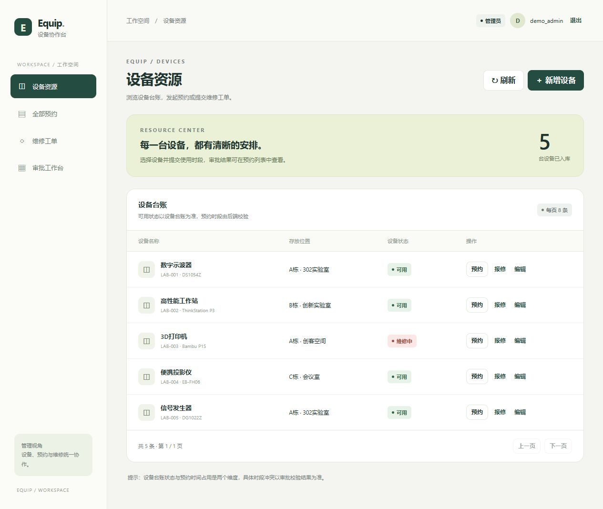
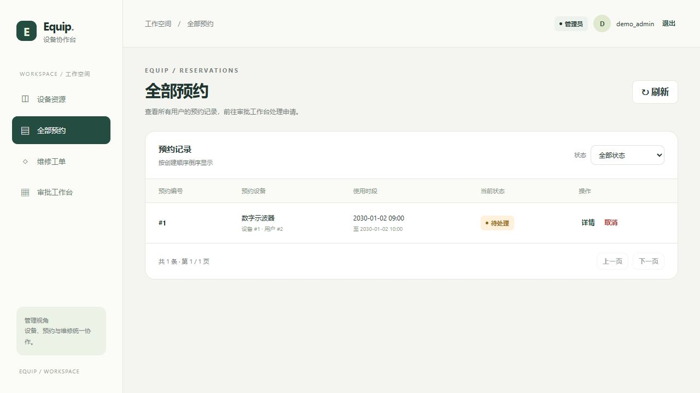
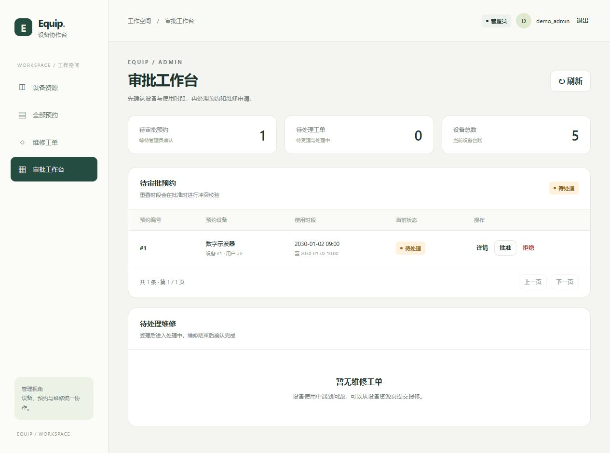

# 设备预约与工单管理平台

公开维护者：**Sweetest**。本项目使用开发者昵称及 GitHub noreply 提交身份；不提供私人联系方式。

基于 Spring Boot、MyBatis 和 MySQL 的设备管理 REST API，覆盖设备台账、设备预约、用户认证与维修工单四类业务。通过 JWT 识别当前用户，通过 USER / ADMIN 角色和记录归属控制访问，并对预约审批、取消及维修状态变更进行并发一致性处理。

这是 Java 后端学习与实习求职展示项目，包含随 Spring Boot 提供的 HTML/CSS/JavaScript 演示端。普通用户可以预约设备、查看个人记录和报修；管理员可以维护设备、审批或拒绝预约、处理维修工单。页面调用真实业务接口，需要启动后端并配置 MySQL。

项目重点：

- **服务端身份与数据权限**：从 JWT 认证上下文获取创建人，普通用户只能查询本人预约和工单，后端校验详情归属。
- **预约审批并发一致性**：READ_COMMITTED 事务、设备行锁、加锁后重读与时间冲突检查，避免重叠预约被并发批准。
- **状态流转约束**：携带旧状态的条件 UPDATE，结合受影响行数校验，防止重复处理和非法跳步。
- **真实接口演示**：用户界面、管理员工作台以及业务失败提示；不依赖前端框架或 npm 构建。
- **可核查的测试**：64 个 Java 测试方法；默认执行 26 个，34 个原有 MySQL 集成测试及4个工单 HTTP 测试需显式启用；另有无 npm 依赖的前端测试。

[页面与演示说明](docs/FRONTEND_GUIDE.md) · [架构与业务流程](docs/ARCHITECTURE.md) · [GitHub 发布说明](docs/GITHUB_RELEASE.md)

## 历史本地交付状态（2026-10-31）

四组本地交付完成后的核验快照为：**7 个本地提交、60 个已跟踪文件，工作区与暂存区干净**。这7个提交包括3个既有匿名提交和4个分组交付提交。

计入当时仅修改 README 与发布说明的文档提交后，共 **8 个本地提交**，仍为 **60 个已跟踪文件**；该次提交结束后核对工作区与暂存区干净。所有提交的作者和提交者均使用 **Sweetest** 与已确认的 GitHub noreply 身份。未设置或连接远程仓库，未推送或公开项目。后续提交会改变计数，实际状态以本地只读核对结果为准。

## Day 13 工单筛选交付（2026-11-02）

维修页面已接入后端状态筛选，保留原有 JWT 和 USER/ADMIN 数据隔离；选择全部时省略 status 参数。新增前端事件测试及可选启用的真实 HTTP 集成测试，未修改后端业务源码或数据库结构。

本次五文件交付提交后，本地历史共 **9 个提交、62 个已跟踪文件**，工作区和暂存区已核对干净。此前8个匿名提交保持原样，新提交继续使用 Sweetest 与已确认的 GitHub noreply 身份。未连接远程、推送或公开项目。下方2026-10-31交付说明及发布说明保留为历史快照。

本轮验证环境为 Windows、JDK 21、Maven 3.9.16、Node.js 内置测试运行器、MySQL 8/InnoDB，使用离线依赖、随机本地 HTTP 端口和独立测试数据库：

| 实际验证 | 结果 |
|---|---|
| 前端逻辑测试 | 5通过，1个需真实服务的用例在独立执行时跳过，随后在 HTTP 集成中执行通过 |
| 新增工单 HTTP 集成 | 4通过、0失败、0跳过；覆盖两个 USER、无工单 USER、ADMIN及实际 app.js 事件请求 |
| 默认 Java 测试 | 64项中26通过、38跳过，无失败或错误 |
| 原有完整 Java 回归 | 原有60项通过；本轮 Maven 共64项、4跳过，跳过的是已单独通过的新增4项 |

用户于本次交付前提供真实浏览器验收：选择 COMPLETED，`GET /repair-orders?status=COMPLETED` 返回200并展示1条已完成工单；选择全部，`GET /repair-orders` 返回200并展示4条工单。这是该账号、该时刻的数据快照，不是每次运行固定的条数，也不计入自动化方法数。本轮自动化重验与该浏览器记录分别列示，未声称重新执行浏览器人工操作。

复跑前端测试：`node --test src/test/frontend/repair-status.test.cjs`。新增 HTTP 测试：`mvn test -Dtest=RepairStatusHttpIntegrationTest -Drepair.status.it=true`，需 Node 可用，并在本地进程环境提供 DB_USERNAME、DB_PASSWORD 和仅指向本地 MySQL 服务、以 `/` 结尾且不含数据库名的 DAY12_DB_BASE；使用安全示例配置私有运行环境。测试创建随机 day12_ 数据库与合成账号，使用随机测试 JWT，不读写日常业务记录。旧全量回归仍按下文三个显式开关启用，必须指向专用测试环境。

未验证：新增浏览器布局/窄屏验收、真实断网与15秒超时注入、全新机器冷启动、Unix Wrapper、公网部署。模拟网络失败测试不能代替真实断网验收。

## 页面预览

以下为独立测试库中的真实页面截图，使用临时演示账号和设备数据；截图账号已清理，不能直接用于登录新下载的项目。

### 设备资源



### 预约记录与审批





登录页见 [截图](docs/images/login.jpg)，完整演示顺序见 [前端说明](docs/FRONTEND_GUIDE.md)。

## 技术栈与结构

| 项目 | 实际配置 |
| --- | --- |
| Java | JDK 21；`pom.xml` 的 `java.version=21` |
| 后端框架 | Spring Boot 4.0.8、Spring MVC |
| 认证授权 | Spring Security、BCrypt、JJWT 0.13.0 |
| 数据访问 | MyBatis Spring Boot Starter 4.0.1、MySQL Connector/J |
| 数据库 | MySQL 8.0、InnoDB、utf8mb4；本次验证为 MySQL 8.0.46 |
| 构建 | Maven；Wrapper 3.3.4（only-script），锁定 Maven 3.10.0 |
| 测试 | JUnit Jupiter、Spring Boot Test、MockMvc、Java HttpClient、Mockito；部分测试依赖真实 MySQL |

```text
src/main/java/com/example/equipmentmanagement/
  controller/    HTTP 路由与当前身份注入
  service/       参数校验、业务规则与事务
  mapper/        MyBatis 注解 SQL
  entity/        数据实体
  dto/           注册、登录、预约、报修请求及当前用户响应
  config/        Spring Security 配置
  security/      JWT 认证过滤器
  util/          JWT 生成与解析
  exception/     异常及 HTTP 状态映射
  common/        分页响应
src/main/resources/static/     同源 HTML/CSS/JavaScript 演示端
src/main/resources/application-example.properties
src/test/java/   默认测试与显式启用的集成测试
schema.sql       手动导入的纯表结构脚本
```

## 四类核心业务

| 业务 | 已实现能力及边界 |
| --- | --- |
| 设备台账 | 按 ID、状态、分页查询；管理员新增、修改、删除。分页按 ID 升序，页码从 1 开始，`pageSize` 为 1–100。新增设备状态由数据库默认设为 `AVAILABLE`；修改接口仅修改名称、位置、型号，不修改设备编码或状态。被外键引用的设备删除返回 409。 |
| 设备预约 | 当前登录用户创建预约，初始 `PENDING`；管理员批准为 `APPROVED` 或拒绝为 `REJECTED`；支持分页、状态/设备筛选、按归属查询详情；本人或管理员在开始时间前可取消 `PENDING` / `APPROVED` 预约，转为 `CANCELLED`。冲突只计算同设备的 `APPROVED` 记录，条件为 `start_time < 新结束时间 AND end_time > 新开始时间`，因此首尾相接允许，多个重叠待审批申请可能共存。审批与取消使用事务、设备行锁及条件更新。 |
| 用户认证 | 注册、BCrypt 密码散列、登录签发 JWT；注册固定普通用户角色，不接受客户端指定 ADMIN。JWT subject 保存用户 ID；每次认证读取数据库中的当前用户与角色。示例过期时间为 3,600,000 毫秒（1 小时）。 |
| 维修工单 | 当前用户报修，初始 `PENDING`；管理员受理为 `PROCESSING`，再完成为 `COMPLETED`；带旧状态条件的更新防止并发重复流转。USER 列表仅本人、详情按归属校验；ADMIN 可查询全部。后端支持可选 `status` 筛选，列表按 ID 倒序；Web 页面按所选状态调用后端接口筛选。 |

预约和工单的创建人由服务端当前身份确定，不能通过请求中的 `userId` 冒用他人。预约、工单初始状态均不由客户端决定。已提供预约列表、详情和拒绝接口；当前没有工单取消、用户管理或角色提升 API。

## 权限

| 操作 | 未登录 | USER | ADMIN |
| --- | --- | --- | --- |
| 注册、登录 | 允许 | 允许 | 允许 |
| 设备查询 | 401 | 允许 | 允许 |
| 设备新增、修改、删除 | 401 | 403 | 允许 |
| 创建预约、创建报修 | 401 | 以本人身份创建 | 以本人身份创建 |
| 批准/拒绝预约、受理/完成工单 | 401 | 403 | 允许 |
| 取消预约 | 401 | 仅本人，且满足时间/状态条件 | 可取消他人，但仍受时间/状态条件限制 |
| 查询预约/工单 | 401 | 列表仅本人；他人详情 403 | 全部 |
| 当前用户 `/users/me` | 401 | 仅必要身份字段 | 仅必要身份字段 |

受保护接口使用 `Authorization: Bearer <本地登录得到的JWT>`。应用使用无状态认证，禁用表单登录、HTTP Basic 和 CSRF；当前没有刷新令牌、注销/令牌黑名单功能。令牌无效、过期或对应用户不存在时返回 401。上述公开入口指无无效 Authorization 头的请求；主动携带无效 JWT 仍可能先被过滤器拒绝。

## 启动前提与安全配置（Windows PowerShell）

1. 安装 JDK 21，确认 `java -version`、`JAVA_HOME` 和命令行实际使用同一个 JDK。
2. 启动 MySQL 8.0，准备独立开发数据库。`schema.sql` 使用 `utf8mb4_0900_ai_ci`，不直接保证兼容 MySQL 5.7 或 MariaDB。
3. 首次运行 Wrapper 需要网络下载 Maven，首次构建需要下载依赖。也可使用已安装的 Maven；本次默认测试实测使用 Maven 3.9.16，Wrapper 实测使用 Maven 3.10.0。

进入项目根目录，**新检出且本地配置不存在时**复制示例；已有配置请保留，不要覆盖：

```powershell
Set-Location '你的项目目录'
if (!(Test-Path src\main\resources\application.properties)) {
    Copy-Item src\main\resources\application-example.properties src\main\resources\application.properties
}
```

示例通过四个环境变量取值：`DB_URL`、`DB_USERNAME`、`DB_PASSWORD`、`JWT_SECRET`。以下在当前 PowerShell 会话设置，不把数据库口令写入命令历史或文档：

```powershell
$env:DB_URL = 'jdbc:mysql://127.0.0.1:3306/equipment_management?serverTimezone=Asia/Shanghai&characterEncoding=UTF-8'
$dbCredential = Get-Credential -Message '输入本机开发数据库账户与密码'
$env:DB_USERNAME = $dbCredential.UserName
$env:DB_PASSWORD = $dbCredential.GetNetworkCredential().Password

$keyBytes = New-Object byte[] 32
$rng = [System.Security.Cryptography.RandomNumberGenerator]::Create()
try { $rng.GetBytes($keyBytes) } finally { $rng.Dispose() }
$env:JWT_SECRET = [Convert]::ToBase64String($keyBytes)
```

`JWT_SECRET` 应为至少 32 个安全随机字节的 Base64 编码，不能使用短字符串或公开示例密钥。上述命令每次生成新密钥，重启后更换密钥会使旧令牌失效；需要持续登录时，应在本机安全保存并复用密钥。不要输出、截图或提交这些环境变量、登录令牌、口令、用户数据及密码散列。`.env` 仅被 Git 忽略，应用没有配置自动加载 `.env`。IDE 启动时需在对应运行配置中设置环境变量。

运行应用时使用专用数据库账户；执行全量集成测试还需要下文列出的额外数据库权限。公开部署前需自行配置 HTTPS、部署环境密钥和访问策略；本次仅验证本地开发启动。

## 数据库初始化

`schema.sql` 从实际数据库 `SHOW CREATE TABLE` 核查生成，只有四张表的结构及字符集设置，没有账户、业务行、密码散列值或其他种子数据。保留 `AUTO_INCREMENT` 列属性，去掉原库的自增计数值。脚本不包含 `DROP`、`CREATE DATABASE` 或 `USE`，也不会自动升级已有数据库；请只向新建空库导入，重复导入会因表已存在而报错。

先在 MySQL 客户端连接到本机开发实例（使用交互式口令提示，不在命令参数中写密码）。在客户端执行：

```sql
CREATE DATABASE equipment_management
  CHARACTER SET utf8mb4 COLLATE utf8mb4_0900_ai_ci;
USE equipment_management;
SOURCE <项目目录的绝对路径，使用正斜杠>/schema.sql;
SHOW TABLES;
```

PowerShell 不支持直接照搬其他 shell 的 `< schema.sql` 输入重定向；此处 `SOURCE` 是 **MySQL 客户端命令**。脚本位于仓库根目录，不会由 Spring Boot 自动初始化，需手动导入。

| 表 | 主要字段及约束 |
| --- | --- |
| `users` | 自增主键；`username varchar(50)` 唯一；`password_hash varchar(255)`；`role` 默认 `USER` |
| `device` | 自增主键；`device_code varchar(50)` 唯一；名称/型号上限 50，位置上限 100；状态默认 `AVAILABLE` |
| `reservation` | 设备/用户 ID、起止时间、状态默认 `PENDING`；**实际仅 `device_id` 有外键**，`user_id` 没有外键 |
| `repair_order` | 设备/用户外键；`description varchar(500)`；状态默认 `PENDING`；时间列为 `created_at` 与 **`update_at`**，后者自动更新时间，并由 Mapper 别名映射为 API 的 `updatedAt` |

所有表均为 InnoDB。没有额外的数据库枚举或 CHECK 状态约束，业务状态流转由服务代码和条件 SQL 实现。

空库不含管理员。先通过注册接口创建自己控制的账户，再由数据库管理员在本机开发库中将**确认过的专用账户**提升为 ADMIN，例如替换下列占位符后执行，并核对影响行数为 1：

```sql
UPDATE users SET role = 'ADMIN'
WHERE username = '<你刚注册的专用管理员用户名>' AND role = 'USER';
```

不要把共享默认管理员、口令或密码散列写入 `schema.sql`。若计划运行旧身份绑定集成测试，请保留 `id=1` 为普通 USER，并另注册第二个账户用于管理员操作。

## 启动与构建

```powershell
.\mvnw.cmd -version
.\mvnw.cmd spring-boot:run '-Dspring-boot.run.arguments=--server.address=127.0.0.1'
```

默认端口为 8080，接口地址为 `http://127.0.0.1:8080`。访问 `/` 显示设备协作台登录页；匿名访问受保护业务接口返回 401 属于预期。端口冲突时可在本地配置设置 `server.port`。

也可以构建并运行 JAR（默认构建会按下文默认规则运行测试）：

```powershell
.\mvnw.cmd clean package
java -jar target\equipment-management-0.0.1-SNAPSHOT.jar --server.address=127.0.0.1
```

应用需要的数据库变量和 JWT 密钥须在启动进程环境中可见。注意：**Git 忽略不等于 Maven 排除资源**；本地 `application.properties` 会进入构建产物。如果其中有机器专属口令或地址，不应分发该 JAR。需要分发时，从干净源码和仅含环境变量占位符的配置构建，审查产物，不直接分享本机 `target/`。

`mvnw` / `mvnw.cmd` 与 `.mvn/wrapper/maven-wrapper.properties` 已在版本管理中。only-script 类型不需要提交 `maven-wrapper.jar`。当前 Wrapper 配置包含官方发行地址与 SHA-256。历史交付曾验证发行包获取；最近一次本地交付使用校验一致的本地Maven 3.10.0发行包，验证普通目录和目录联接下的Windows Wrapper `-version`。未据此承诺首次联网下载、无缓存启动或Unix脚本已通过。

## 主要 API

请求 JSON 使用 `Content-Type: application/json`；除注册/登录外，均需 Bearer JWT。

| 方法与路径 | 权限 | 参数/请求体 | 成功响应 |
| --- | --- | --- | --- |
| `POST /users/register` | 公开 | `username`、`password` | HTTP 200，整数 `1` |
| `POST /users/login` | 公开 | `username`、`password` | HTTP 200，原始 JWT 字符串 |
| `GET /devices/{id}` | USER/ADMIN | 正整数路径 ID | 设备对象 |
| `GET /devices?status=AVAILABLE` | USER/ADMIN | 必填非空 `status` | 设备数组；未知非空状态当前返回空数组 |
| `GET /devices/page?page=1&pageSize=10` | USER/ADMIN | 必填 `page`、`pageSize` | `{total,page,pageSize,records}` |
| `POST /devices` | ADMIN | `deviceCode`、`name`、`location`，可选 `model` | 整数 `1` |
| `PUT /devices/{id}` | ADMIN | `name`、`location`，可选 `model` | 整数 `1` |
| `DELETE /devices/{id}` | ADMIN | 路径 ID | 整数 `1` |
| `POST /reservations` | USER/ADMIN | `deviceId`、`startTime`、`endTime` | HTTP 201，保存后的预约对象，含新ID和Location |
| `GET /reservations`（别名 `/reservations/page`） | USER本人/ADMIN全部 | page、pageSize、可选status/deviceId | `{total,page,pageSize,records}` |
| `GET /reservations/{id}` | 本人/ADMIN | 正整数预约ID | 预约详情 |
| `GET /users/me` | 已登录 | 无 | `{id,username,role}` |
| `PUT /reservations/{id}/approve` | ADMIN | 路径预约 ID，无需请求体 | 整数 `1` |
| `PUT /reservations/{id}/reject` | ADMIN | 路径预约 ID，无需请求体 | 整数 `1` |
| `PUT /reservations/{id}/cancel` | 本人/ADMIN | 路径预约 ID，无需请求体 | 整数 `1` |
| `POST /repair-orders` | USER/ADMIN | `deviceId`、`description` | 整数 `1` |
| `GET /repair-orders` | USER/ADMIN | 可选 `status`：PENDING / PROCESSING / COMPLETED | 工单数组，按权限及状态过滤，ID 倒序 |
| `GET /repair-orders/{id}` | 本人/ADMIN | 路径工单 ID | 工单对象 |
| `PUT /repair-orders/{id}/process` | ADMIN | 路径工单 ID，无需请求体 | 整数 `1` |
| `PUT /repair-orders/{id}/complete` | ADMIN | 路径工单 ID，无需请求体 | 整数 `1` |

`GET /repair-orders` 不传 `status` 时返回当前身份可访问的全部工单；传入 `PENDING`、`PROCESSING` 或 `COMPLETED` 时只返回该状态。参数区分大小写，未知值、小写、空字符串（`status=`）和空白值均返回 HTTP 400，正文为“状态不合法”；合法状态没有匹配记录时返回 HTTP 200 和 `[]`。筛选不能扩大普通用户的数据范围。工单下拉框将所选 PENDING、PROCESSING、COMPLETED 作为 status 参数发送给后端；选择全部状态时省略该参数，列表与数量直接使用后端响应。服务端分页和设备筛选尚未实现。

除预约创建接口外，其余写接口的整数 `1` 是受影响行数，**不是新记录 ID**；没有统一的 `{code,message,data}` 响应封装。预约创建返回201和资源Location。查询设备列表/工单列表可以获得相应 ID；预约创建已返回新记录ID，预约分页及详情可通过API查询，无需手工SQL获取预约ID。

预约时间使用不带时区的本地时间格式，如 `2030-01-02T09:00:00`，要求开始时间早于结束时间。当前未实现“必须在未来创建预约”或“只允许 AVAILABLE 设备预约”的额外限制，不应据此作业务承诺。报修描述必填、非空白且服务校验 `String.length() <= 500`。

常见错误：非法参数/畸形 JSON/错误登录信息/不允许的状态变更为 400；未认证为 401；权限或归属不符为 403；设备、预约、工单不存在为 404；唯一键或外键等数据库约束冲突为 409。普通业务异常正文多为字符串，安全过滤器及框架错误响应格式可能不同。服务内部异常可能为 500，不将所有错误承诺为同一种 JSON 格式。

## 测试：默认命令与全部集成测试

在项目根目录执行。PowerShell 中将 `-D...` 参数整体加引号：

```powershell
# 默认：26 项实际执行，38 项按条件跳过
mvn test
# 使用 Wrapper 的等价入口
.\mvnw.cmd test

# 原有完整回归：60项执行，新增4项工单测试按条件跳过；需满足后述数据库前提
.\mvnw.cmd test '-Dfull.regression.it=true' '-Dreservation.identity.it=true' '-Dreservation.cancel.it=true'
```

| 测试类 | 方法数 | 默认执行 | 验证方式/启用开关 |
| --- | ---: | ---: | --- |
| `EquipmentManagementApplicationTests` | 1 | 1 | 应用上下文装配；不能据此声称真实数据库业务已验证 |
| `JwtAuthenticationIntegrationTest` | 16 | 16 | 嵌入式服务与真实 HTTP，数据库 Mapper 使用 mock |
| `JwtUtilTest` | 3 | 3 | JWT 单元测试 |
| `ReservationQueryTest` | 6 | 6 | Mockito 验证查询范围、分页边界、状态和归属 |
| `FullRegressionIntegrationTest` | 13 | 0 | 真实 HTTP + 独立 MySQL 库；`full.regression.it=true` |
| `ReservationIdentityBindingIntegrationTest` | 5 | 0 | MockMvc + 配置的真实 MySQL 库，事务回滚；`reservation.identity.it=true` |
| `ReservationCancelOwnershipIntegrationTest` | 16 | 0 | 真实 HTTP + 独立 MySQL 库；`reservation.cancel.it=true` |
| `RepairStatusHttpIntegrationTest` | 4 | 0 | 真实 HTTP + 新建 MySQL 库 + Node 前端事件；`repair.status.it=true` |
| **合计** | **64** | **26** | **默认跳过38；原三开关执行60，新增工单套件单独执行4** |

当前源码共64个 Java 测试方法。默认命令执行26个、跳过38个；原有全量命令执行60个、跳过新增4个，工单套件另行显式启用。数据库测试需满足下列前提。根目录 DEV-030 报告保留的是此前 50 项测试的历史记录，不能作为当前测试数量。

### 历史自动化复验与本地交付核验（2026-10-30—2026-10-31）

| 范围 | 本地交付阶段实际结果 |
| --- | --- |
| 默认自动化测试 | 发现60项，26项执行通过、34项按条件跳过，0失败、0错误 |
| 全量自动化测试 | 启用full.regression.it、reservation.identity.it、reservation.cancel.it三个开关；60项全部通过，0失败、0错误、0跳过 |
| Windows Wrapper | 使用SHA-256与固定校验值一致的本地Maven 3.10.0发行包，在普通目录与目录联接两种场景运行 `-version` 均通过 |
| 前端脚本 | `app.js` 语法检查通过；本轮没有新增浏览器人工操作验收 |

测试环境：Windows 11、JDK 21、Maven 3.9.16、MySQL 8.0/InnoDB；在仓库外的临时源码副本和可写离线依赖缓存运行，实际重新编译主源码与测试源码。测试JDBC时区使用UTC。配置库为新建专用测试种子库，只有结构与合成USER id=1；真实数据库集成测试另建独立库，未将日常业务库用作测试配置库。测试结束时种子库仅保留合成用户，两个独立集成测试库的夹具已清空，回滚与清理检查通过。

本次2026-10-31文档修订只核对上述已完成的执行证据，没有再次运行业务测试或访问数据库。测试结果不包含初始化失败或环境诊断尝试；原始日志、XML、临时数据库配置及本机路径均不纳入公开仓库。

未验证事项：实际390px布局、15秒超时/断网注入、无缓存新机器冷启动、Unix Wrapper、公网部署，以及本次Windows Wrapper首次联网下载路径。自动化中的HTTP请求不等于新一轮浏览器验收；此前独立82次HTTP请求和31项浏览器通过属于下述历史复验，不与60个测试方法相加。

### 此前页面与独立接口复验（2026-10-30）

| 范围 | 实际结果 |
| --- | --- |
| 默认自动化测试 | 60 项发现，26 项执行通过，34 项按条件跳过；0 失败、0 错误 |
| 全量自动化测试 | 三个集成测试开关全部启用；60 项执行通过，0 失败、0 错误、0 跳过 |
| 独立 HTTP 验收 | 82 次请求：70 次核心验收、8 次分页夹具准备、4 次页面结果持久化核对；状态及数据断言符合预期，不将请求数相加到 JUnit 方法数 |
| 浏览器验收 | 31 项通过；另有 1 次加载中采集由等待加载完成后的重验替代，1 项窄屏视口设置未生效而未完成 |
| 数据和代码保护 | 当前服务使用专用临时数据并在验收后清理；四张表原有记录指纹一致，原项目源码、配置、Git HEAD 和工作区状态一致 |

该轮使用当前源码的工作区副本、JDK 21、Maven 3.9.16 和已有依赖缓存运行测试。自动化测试使用独立 MySQL 测试环境；对运行中服务的页面与接口验收使用专用临时账号和业务记录。通过范围包括登录、设备增改分页、预约创建/查询/审批/冲突/拒绝/取消、工单提交/受理/完成、状态筛选及用户数据隔离。

本轮未认证 390px 窄屏：设置视口后实际宽度仍为 1280px；未注入 15 秒请求超时或断网；未验证无缓存的新机器冷启动、Unix Wrapper 或公网部署。不能将这些项目写成通过。控制台采集未出现 warn/error 消息，不等于所有网络请求均返回 200。详细范围见[前端说明](docs/FRONTEND_GUIDE.md#最近一次复验2026-10-30)和[发布说明](docs/GITHUB_RELEASE.md)。

此前安全修订和匿名身份处理没有改变业务或测试代码；其后的本地交付阶段重新执行了默认与全量测试，结果见上方最新摘要。此处保留的是此前页面与独立接口复验记录，不把本次文档核对算作业务测试。原始日志、XML、Token、私有配置、匿名化报告及提交ID映射不作为公开附件。

全量测试前提与已知限制：

- 测试源码中两组独立库测试直接用 `Properties.load` 读取 `src/main/resources/application.properties`。它们对用户名、密码支持环境变量解析，**对 URL 不解析 `${DB_URL}`**。仅复制配置示例后，应用能启动，但这两组测试不能直接运行。运行全量前，请在 Git 忽略的本地配置中将 `spring.datasource.url` 设置成专用测试库的具体 JDBC URL（最近一次复验使用 `serverTimezone=UTC`）；用户名、密码继续保留 `${DB_USERNAME}` / `${DB_PASSWORD}`。不要修改安全示例为个人凭据，也不要提交本地配置。
- 使用专用开发/测试 MySQL 实例；配置库中已存在上述四张 InnoDB 表。旧身份绑定测试要求 `users.id=1` 存在且 `role='USER'`，并要求 users/device/reservation 无触发器。在新空库先通过注册 API 创建第一个普通账户，不要把它提升为 ADMIN。脚本不为满足测试导出真实用户。
- 全量和取消测试创建随机名 `dev029_*`、`dev027_*` 数据库，只复制结构并插入临时夹具。数据库账户需有建库、建表、相应 DML 权限；并发回归还需读取 `performance_schema.data_lock_waits`、`performance_schema.threads`。这些是测试权限，不是普通应用运行所必需的权限。
- 身份绑定测试在配置库内插入后回滚，正常运行不保留测试行，但 MySQL 自增计数可能前进。独立库测试正常结束清空自己的夹具，保留库和空表；外部强制终止可能遗留夹具，应按明确测试库名检查，不要清空业务库。
- 取消测试有一个故障注入用例，预期收到 HTTP 500 并检查事务回滚。应以 Surefire 最终失败/错误数判断结果，不将预期日志堆栈误判为回归失败。

项目没有配置专门启用这些开关的 Maven profile 或 Failsafe 流程。`mvn verify` 不会自动把条件测试全部启用，`-DskipTests` 会跳过测试。原报告中的 `-o` 表示离线解析 Maven 依赖，只在相关依赖/插件已缓存时可用；它不是集成测试开关，也不阻止未缓存 Wrapper 自行下载 Maven。

只运行无需数据库配置的认证/JWT测试可使用：

```powershell
.\mvnw.cmd test '-Dtest=JwtAuthenticationIntegrationTest,JwtUtilTest'
```

Surefire 结果位于 `target/surefire-reports/`，后一次运行会刷新同名报告。查看本次交付报告时应区分默认与全开两次执行，不能把默认 BUILD SUCCESS 等同于 60 项全部执行。

## 兼容变化与已知边界

- `POST /reservations` 由早期的 HTTP 200 + 整数 1 改为 **HTTP 201 + 保存后的预约对象**，并返回 `Location: /reservations/{id}`。旧请求集合应改为读取响应 JSON 的 `id`。
- 当前没有 Swagger/OpenAPI 页面、统一响应封装、刷新令牌或服务端注销机制。前端退出仅清除当前标签页凭据。
- 页面是同源静态资源，需要通过运行中的 Spring Boot 访问，不能双击 HTML 或仅放到静态托管服务后就获得完整功能。
- 新空库没有共享默认账号；注册得到 USER，ADMIN 由数据库管理员对自己控制的专用账号配置。
- 维修工单列表目前没有服务端分页；窄屏表格仍可继续优化。
- 全量测试仍依赖本地配置、MySQL 权限和 USER id=1；默认测试成功不代表真实数据库并发已在当前机器复验。

## 版本管理与分发

提交源码、测试、Maven Wrapper、配置示例、纯结构脚本和 `docs/`。本地 `application.properties`、开发/生产私有配置、IDE 私有运行配置、环境变量文件、构建产物、日志、备份和验证运行目录均不纳入默认上传范围。忽略规则保留安全的 `application-example.properties` 和纯结构 `schema.sql`，不统一忽略所有 SQL。历史材料仍保留在本机；`.gitignore` 不会阻止配置进入构建产物，也不保护网页拖拽或手工压缩上传。

根目录 `DEV-030_DELIVERY_REPORT.md` 保留当时的历史交付事实，阅读当前功能和测试时以本 README 及最新源码为准。公开说明不附身份替换前的提交标识或旧新对照表。

不要把整个本地文件夹直接拖到 GitHub 上传：网页上传不会替你执行本地 Git 忽略规则。使用 Git 的文件清单，或使用发布前生成的干净源码包。步骤与实际验证范围见 [GitHub 发布说明](docs/GITHUB_RELEASE.md)。
