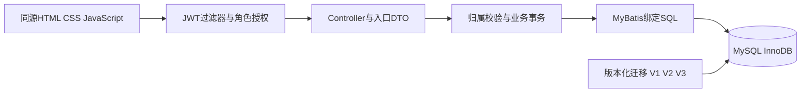

# V3架构与职责

Controller取得认证上下文，不接受客户端自称ADMIN或创建人。查询DTO在边界校验页码、状态、设备ID和关键词；Service流转同一查询及owner范围，不依赖前端权限。Mapper负责绑定参数与条件SQL，实体映射原update_at为API updatedAt。

JwtAuthenticationFilter验证签名/subject后读取当前账号和角色；SecurityConfig约束ADMIN操作。Service对预约/工单详情和历史检查归属，USER列表与count使用同一owner条件。角色从数据库读取，不由请求体提供。

预约创建/批准/取消、维修创建/受理/完成在相关事务中锁同一设备行。审批锁后重读，排除状态已变化，再检查已有APPROVED满足start_time<新end且end_time>新start；首尾相接允许，重叠PENDING可并存。受理/完成/审批用条件UPDATE，行数不为1时拒绝重复处理。

维修采用READ_COMMITTED，锁后重读工单并清理Mapper本地缓存。创建写工单+CREATED；受理保存可靠首次维修前状态、设备MAINTENANCE、工单PROCESSING及PROCESSED；完成写COMPLETED历史，仅无未完成单且快照可靠、没有恢复暂停时恢复设备。异常使同事务状态/设备/历史整体回滚。

V1建原四表。V2增加历史表、status_before_maintenance和查询索引。V3新增history_complete、maintenance_restore_blocked、review_note：旧记录只做有依据的元数据分类，不生成历史；设备级暂停避免兄弟工单掩盖旧不确定性。人工核对不会解除暂停。

工单分页按ID倒序，count与records共享权限/筛选，跨请求不提供冻结快照。OPEN仅新分页查询聚合PENDING/PROCESSING；旧数组接口兼容三状态。数据库索引覆盖常用owner/status/device过滤，关键词包含匹配不承诺大规模检索性能。

前端使用真实接口，保留轻量技术；设备目录关联与搜索仍收集授权目录后浏览器处理。未引入缓存/队列/分布式事务。测试证据与数量统一看[TESTING](TESTING.md)，不将历史分批结果累加为当前通过总数。
