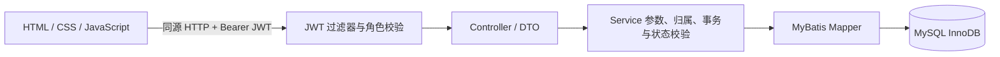
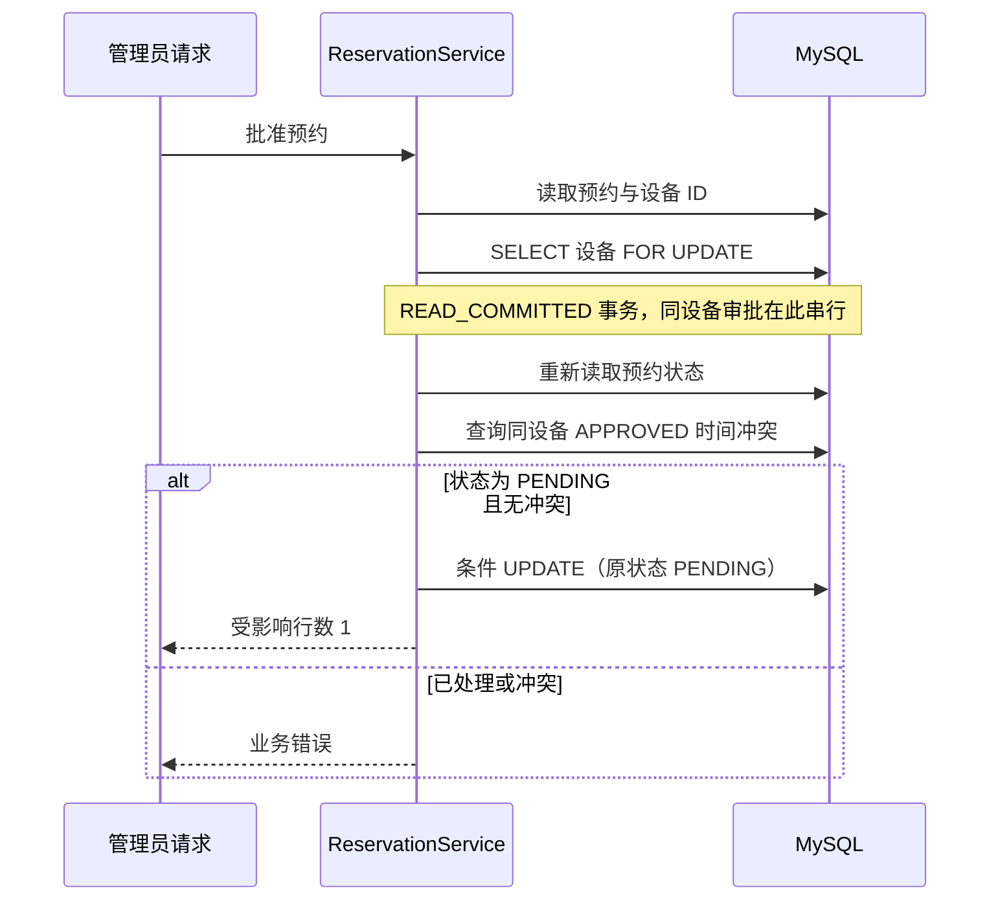

# 架构与业务流程

## 请求链路

静态页面由同一 Spring Boot 应用提供。JWT subject 为用户 ID；过滤器从数据库读取当前用户和角色。前端隐藏管理按钮只改善操作体验，实际权限由后端决定。`GET /users/me` 仅返回 id、username、role。

## 预约审批

冲突区间使用 `已有开始 < 新结束 AND 已有结束 > 新开始`，因此首尾相接允许。重叠 PENDING 可以共存，但不应同时被批准。创建预约时的冲突预检查不能替代审批事务中的再次检查。

## 状态与归属

| 对象 | 允许的流转 | 附加限制 |
| --- | --- | --- |
| 预约 | PENDING → APPROVED / REJECTED | 批准、拒绝仅 ADMIN；批准检查时间冲突 |
| 预约 | PENDING / APPROVED → CANCELLED | 本人或 ADMIN；开始时间前；取消与审批协调设备锁 |
| 工单 | PENDING → PROCESSING → COMPLETED | ADMIN；条件 UPDATE 防止重复流转 |

预约列表、工单列表限制 USER 为本人记录；ADMIN 可查询全部。详情再次校验归属，不能靠修改前端参数越权。当前没有工单取消、用户管理或角色提升接口。

## 测试层次

- 无真实数据库：JWT 单元测试、预约查询服务 Mockito 测试、带真实 HTTP 的认证链测试、应用装配测试。
- 真实 MySQL：身份绑定与归属、创建响应和查询契约、并发审批和重复取消、故障注入与回滚。
- 默认执行 26 项；34 项数据库集成测试通过三个系统属性显式启用。集成测试的数据库和权限前提见 README。

本文描述当前实现；不把尚未开发的能力列为完成项。
